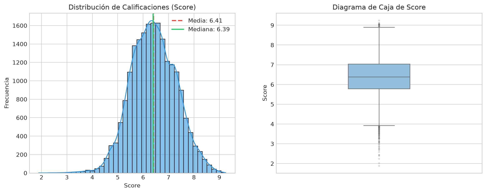
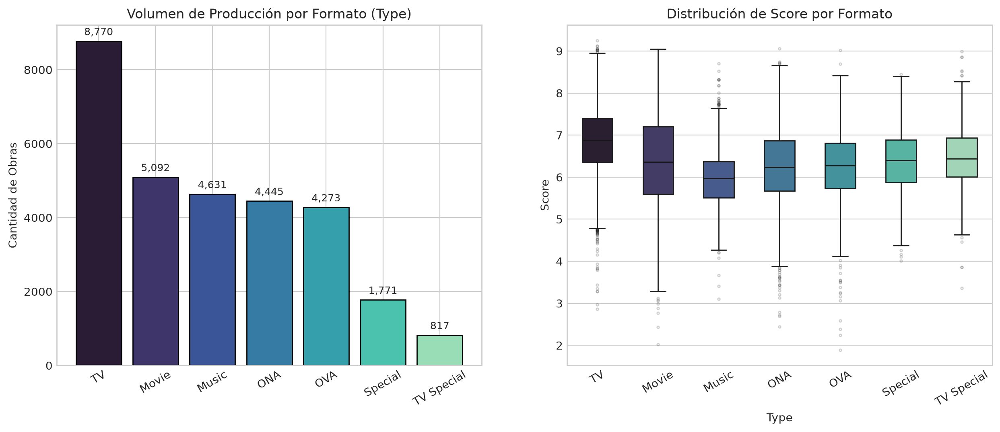
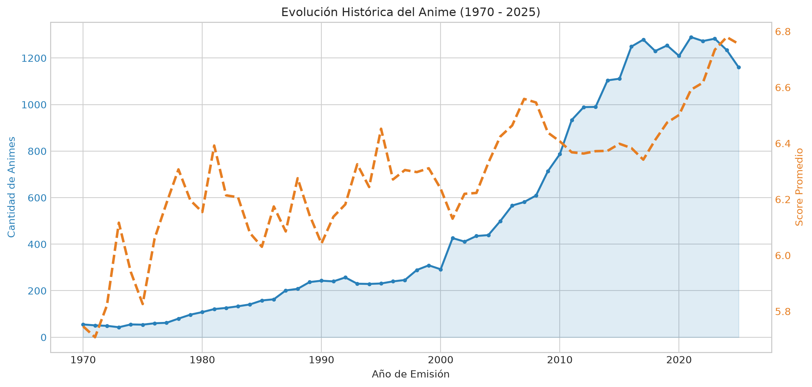
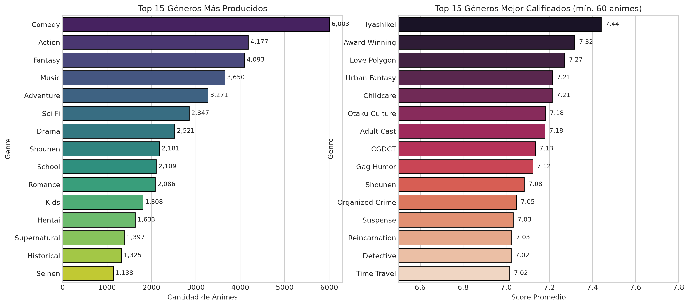
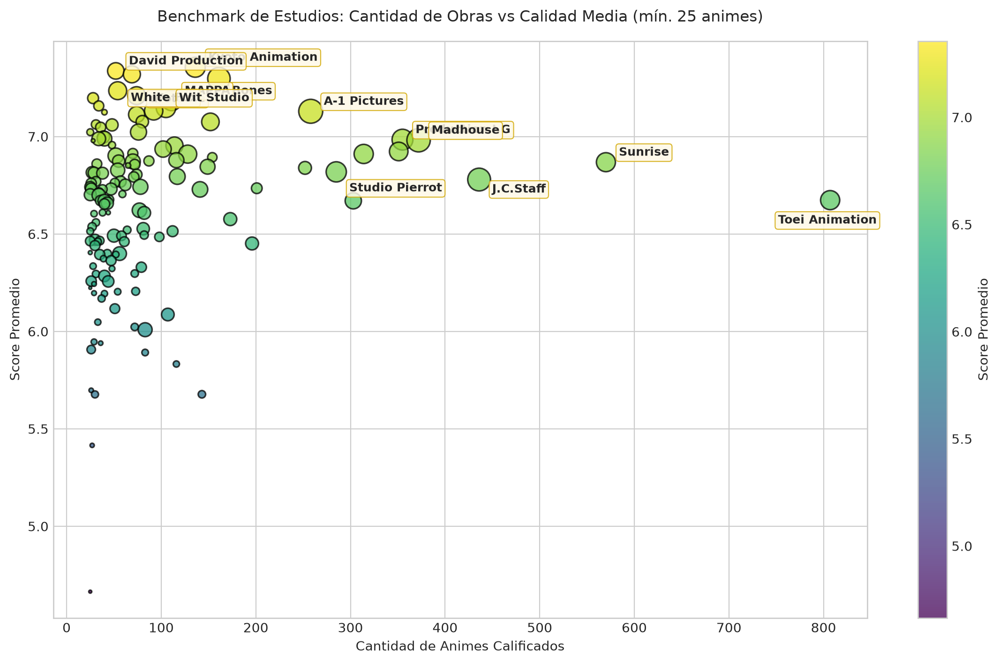
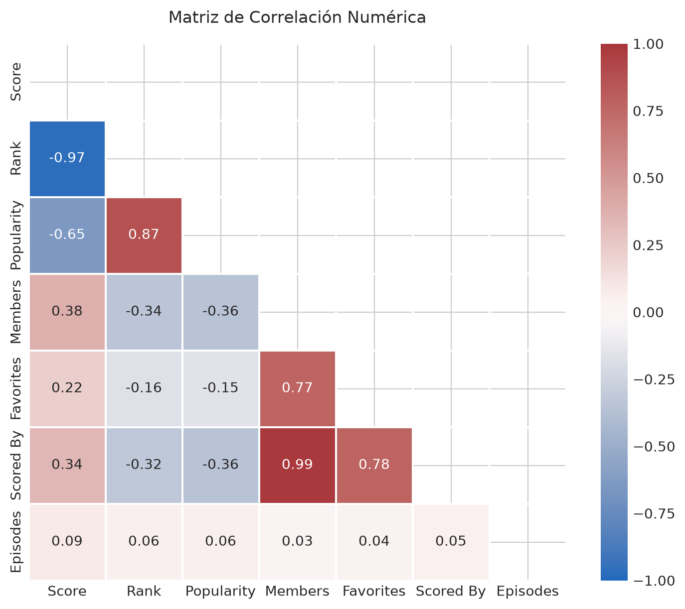

# 🎬 Anime Exploratory Data Analysis (EDA) - 2026

[](https://www.python.org/)
[](https://opensource.org/licenses/MIT)
[](https://pandas.pydata.org/)
[](https://seaborn.pydata.org/)

Análisis exploratorio de datos (EDA) exhaustivo sobre el catálogo histórico de **MyAnimeList (MAL)**, compuesto por **30,763 producciones** y **24 variables**.

Este proyecto contiene un pipeline modular en Python para la limpieza, transformación, cálculo estadístico y generación automatizada de visualizaciones de alta resolución sobre la evolución, formatos, géneros y estudios de la industria del anime.

---

## 📑 Tabla de Contenidos

- [Características Principales](#-características-principales)
- [Estructura del Proyecto](#-estructura-del-proyecto)
- [Principales Hallazgos](#-principales-hallazgos)
  - [1. Distribución de Calificaciones (Score)](#1-distribución-de-calificaciones-score)
  - [2. Formatos de Emisión](#2-formatos-de-emisión)
  - [3. Evolución Histórica (1970 - 2025)](#3-evolución-histórica-1970---2025)
  - [4. Géneros Más Frecuentes vs. Mejor Calificados](#4-géneros-más-frecuentes-vs-mejor-calificados)
  - [5. Benchmark de Estudios de Animación](#5-benchmark-de-estudios-de-animación)
  - [6. Matriz de Correlación](#6-matriz-de-correlación)
- [Instalación y Requisitos](#-instalación-y-requisitos)
- [Uso y Ejecución](#-uso-y-ejecución)
- [Licencia](#-licencia)

---

## 🚀 Características Principales

* **Normalización de Datos**: Tratamiento de valores centinela (`UNKNOWN`), imputación e inferencia de tipos de datos.
* **Extracción Temporal**: Parsing de años de emisión a partir de campos textuales desestructurados (`Premiered` y `Aired`).
* **Visualizaciones Listas para Publicación**: Generación de 8 gráficos estadísticos a 200 DPI exportados a [`eda_plots/`](eda_plots/).
* **Código Modular y Documentado**: Arquitectura basada en funciones con Docstrings (PEP 257) y tipado estático (Type Hints).

---

## 📂 Estructura del Proyecto

```text
├── EDA_4_Anime.py           # Script principal con el pipeline de limpieza y visualización
├── anime-dataset-2026.csv   # Dataset con 30,763 registros históricos de MyAnimeList
├── requirements.txt         # Dependencias del proyecto (pandas, seaborn, etc.)
├── .gitignore               # Filtro de archivos compilados, caches y temporales
├── README.md                # Documentación principal del repositorio
└── eda_plots/               # Visualizaciones generadas automáticamente
    ├── 01_distribucion_score.png
    ├── 02_analisis_formatos.png
    ├── 03_evolucion_historica.png
    ├── 04_top_generos.png
    ├── 05_benchmark_estudios.png
    ├── 06_matriz_correlacion.png
    ├── 07_top_animes.png
    └── 08_fuente_adaptacion.png
```

---

## 📊 Principales Hallazgos

### 1. Distribución de Calificaciones (Score)
La media global de calificación se ubica en **6.41** ($\pm 0.89$), con una mediana de **6.39**. El 50% central de las obras se sitúa entre **5.79** y **7.04**. Obtener una nota superior a **8.0** coloca a un anime en el percentil superior del 3.5% histórico.

<p align="center">
  
</p>

### 2. Formatos de Emisión
Las series de televisión (**TV**) representan el **28.5%** del catálogo y logran el promedio de calificación más alto (**6.75**), superando a películas (**6.54**) y formatos web (**ONA: 6.08**).

<p align="center">
  
</p>

### 3. Evolución Histórica (1970 - 2025)
La producción experimentó un crecimiento exponencial desde los años 2000, estabilizándose en torno a **1,200 - 1,300 títulos anuales** a partir de 2016. Desde 2018 se observa un repunte sostenido en la calificación media debido a mayores estándares técnicos y temporadas más compactas.

<p align="center">
  
</p>

### 4. Géneros Más Frecuentes vs. Mejor Calificados
Mientras que **Comedy** (6,003), **Action** (4,177) y **Fantasy** (4,093) dominan en volumen, los géneros con mayor aclamación promedio son temáticas de nicho como **Iyashikei** (**7.44**) y **Award Winning** (**7.32**).

<p align="center">
  
</p>

### 5. Benchmark de Estudios de Animación
* **Líderes en Calidad Crítica** (mín. 25 animes): **Kyoto Animation** (7.36), **David Production** (7.34), **Bones** (7.30), **ufotable** (7.21) y **Wit Studio** (7.21).
* **Líderes en Volumen Industrial**: **Toei Animation** (940 obras, 6.67) y **Sunrise** (594 obras, 6.87).

<p align="center">
  
</p>

### 6. Matriz de Correlación
Existe una correlación casi perfecta ($r = 0.99$) entre el número de usuarios que agregan una serie a su lista (`Members`) y los que emiten un voto (`Scored By`). El número de episodios no muestra correlación significativa con la calidad final ($r = 0.09$).

<p align="center">
  
</p>

---

## ⚙️ Instalación y Requisitos

1. **Clonar el repositorio**:
   ```bash
   git clone https://github.com/TU_USUARIO/TU_REPOSITORIO.git
   cd TU_REPOSITORIO
   ```

2. **Crear y activar un entorno virtual (recomendado)**:
   ```bash
   # En Windows
   python -m venv .venv
   .venv\Scripts\activate

   # En Linux / macOS
   python3 -m venv .venv
   source .venv/bin/activate
   ```

3. **Instalar dependencias**:
   ```bash
   pip install -r requirements.txt
   ```

---

## 💻 Uso y Ejecución

Para ejecutar el pipeline completo de limpieza y regenerar todas las gráficas estadísticas:

```bash
python EDA_4_Anime.py
```

Las figuras se guardarán automáticamente en la carpeta `eda_plots/` en formato `.png` de alta resolución.

---

## 📄 Licencia

Este proyecto se distribuye bajo la licencia **MIT**. Para más información, consulta el archivo `LICENSE`.
